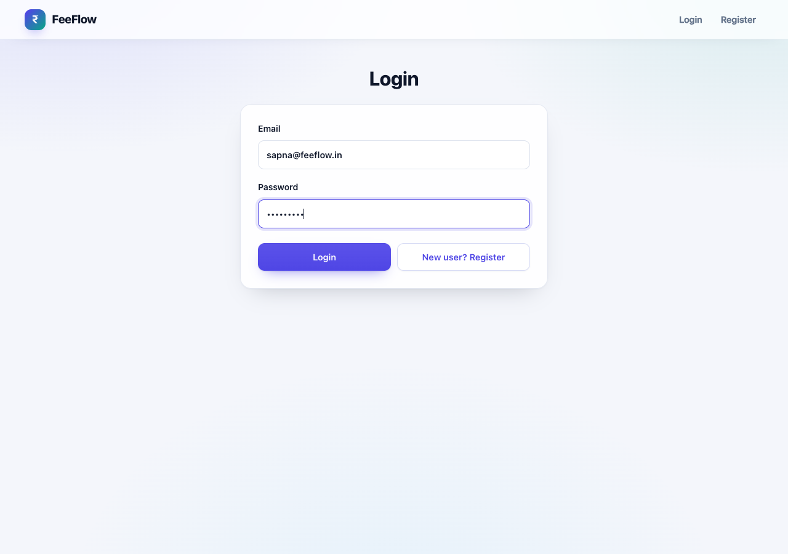
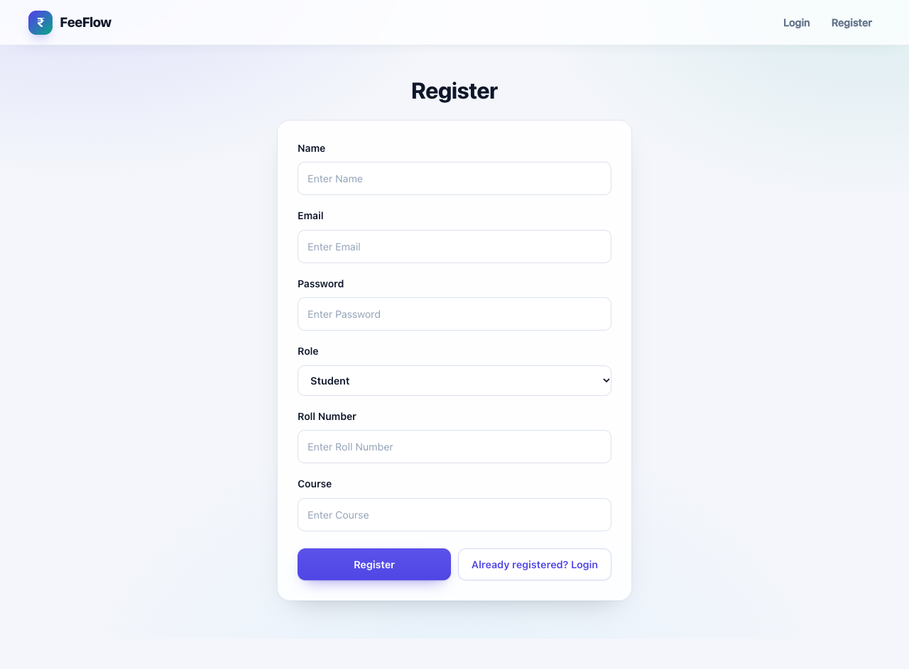
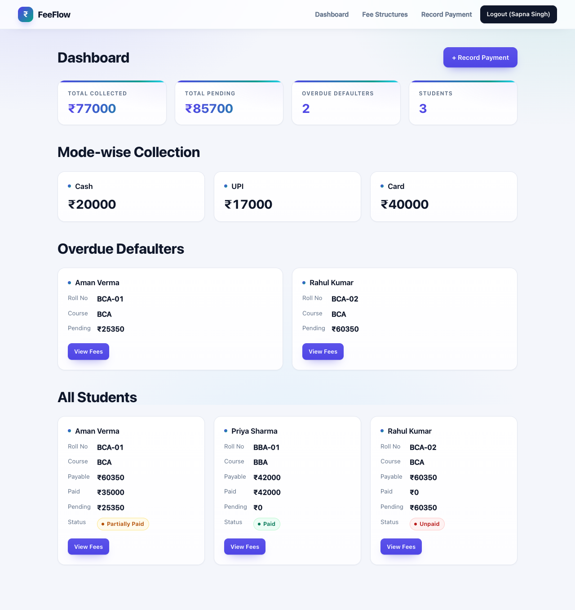
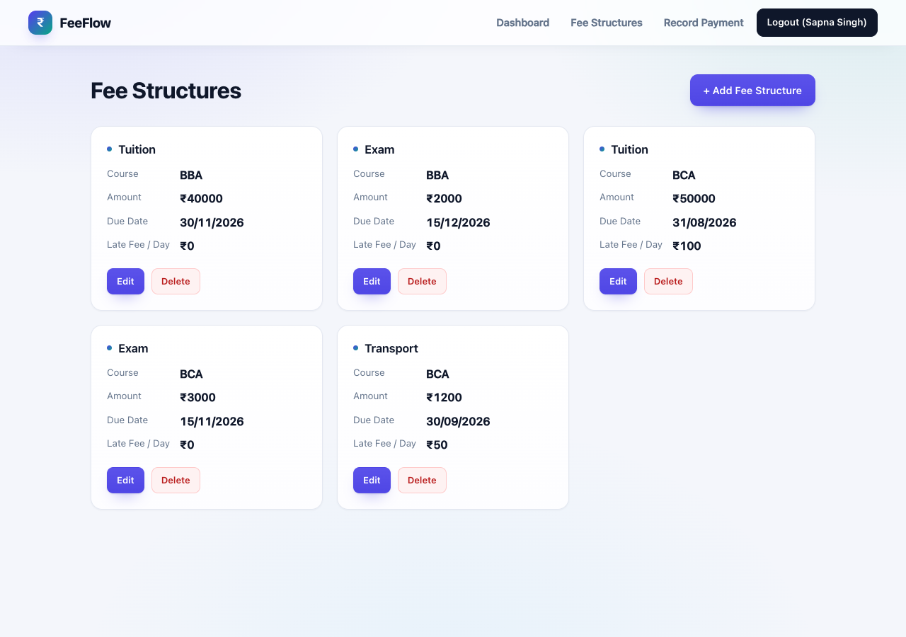
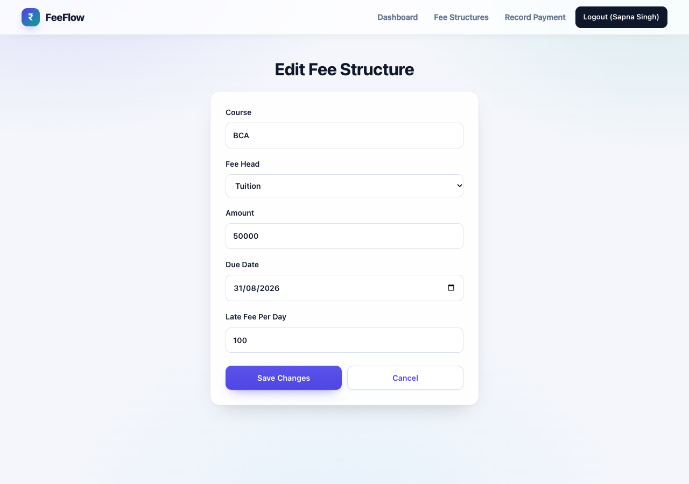
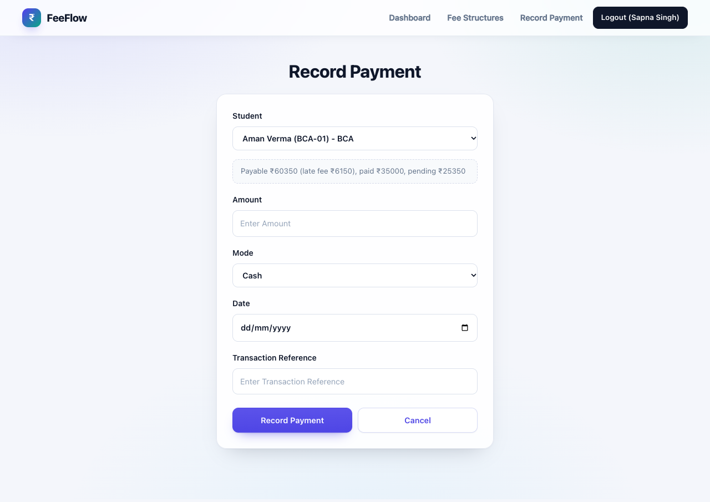
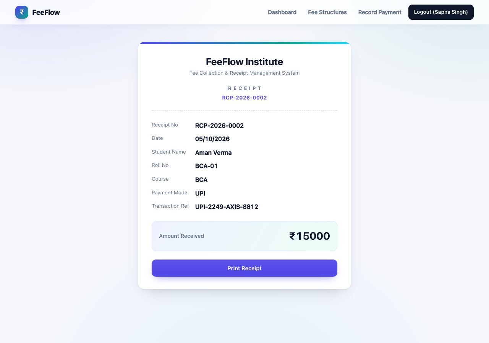
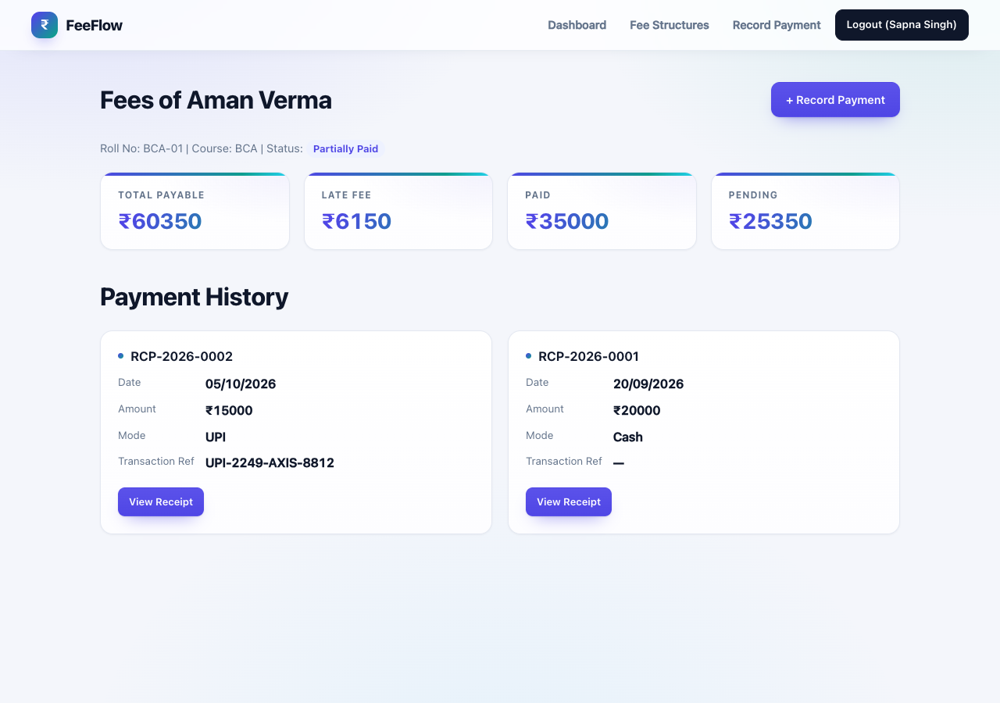
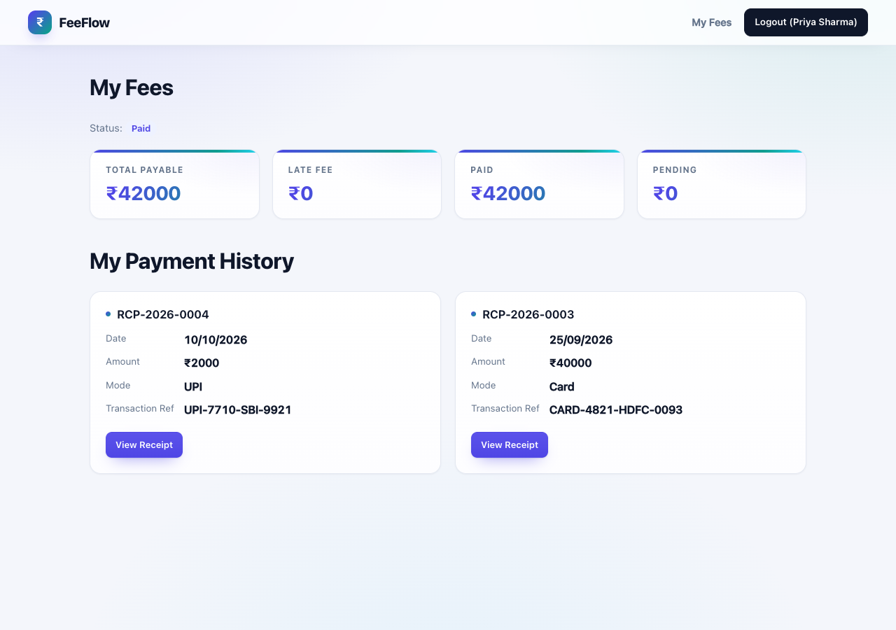

<<<<<<< HEAD
# FeeFlow frontend

React (Vite) client for the FeeFlow backend, in the Lect-31 style: `App.jsx`
holds the `BrowserRouter`, the navbar (`Link`s that change with the role) and
all `Route`s; each page is a small component in `src/components/` that calls
`fetch('/api/...')` directly with the Bearer token from `localStorage`.
Vite proxies `/api` to the backend on port 3000.

## Run

```bash
npm install
npm run dev     # http://localhost:5173
```

The backend must be running on port 3000 (`cd ../backend && npm start`).

## Pages → API

| React route | API used |
| --- | --- |
| `/login` | `POST /api/auth/login` |
| `/register` | `POST /api/auth/register` |
| `/admin/dashboard` | `GET /api/dashboard` |
| `/admin/fees` | `GET/DELETE /api/fees(/:id)` |
| `/admin/fees/new` | `POST /api/fees` |
| `/admin/fees/:id/edit` | `GET /api/fees` + `PUT /api/fees/:id` |
| `/admin/payments/new` | `GET /api/students`, `GET /api/students/:id/fees`, `POST /api/payments` |
| `/admin/students/:id/fees` | `GET /api/students/:id/fees` |
| `/my-fees` | `GET /api/students/:id/fees` (own id from `localStorage`) |
| `/receipts/:receiptNo` | `GET /api/payments/receipt/:receiptNo` |

Role checks: the navbar only shows the links of the logged-in role and the
backend re-checks the JWT role on every request (a student calling
`/api/dashboard` gets 403).

Checks: `npm run lint` (oxlint) and `npm run build` both run clean.
=======
<h1 align="center">FeeFlow</h1>

<p align="center">
  <strong>Fee Collection & Receipt Management System</strong><br />
  A role-based fee management app for institutes — fee structures, payment collection, dues tracking
  and printable receipts.
</p>

<p align="center">
  
  
  
  
  
</p>

| | |
| --- | --- |
| **PS Number** | PS3 |
| **Project Name** | FeeFlow – Fee Collection & Receipt Management System |
| **Problem Statement** | An institute records fee payments, tracks dues and issues receipts. Admin manages fee structures per course and records payments; students view their fee summary, payment history and receipts; a dashboard shows collections, dues and defaulters. |
| **Stack** | React 19 · Vite 8 · Express 5 · MongoDB · JWT |

## About

FeeFlow is an institute fee management app with two roles. An **admin** defines fee heads per course
(Tuition, Exam, Transport) with an amount, due date and optional late fee per day; records payments
in **Cash / UPI / Card**; and reviews a dashboard of total collected, total pending, mode-wise
collection and overdue defaulters. Every payment automatically gets a unique receipt number
(`RCP-2026-0001`, `RCP-2026-0002`, …) and a printable receipt page.

A **student** registers with a roll number and course, then sees total payable, late fee, paid and
pending amounts, their current status, and every payment with its receipt.

## Features

### Admin

- Create, edit and delete fee structures for any course, with due dates and per-day late fees
- Record full or partial payments and reject invalid amounts (zero, negative or above pending)
- Unique, auto-generated receipt number for every payment, with a print-ready receipt page
- Dashboard with total collected, total pending, overdue defaulters, student count and mode-wise totals
- Open any student's ledger to see their fee summary and complete payment history

### Student

- Self-registration with roll number and course
- Live fee summary: total payable, late fee, paid and pending
- Automatic status: **Paid / Partially Paid / Unpaid**
- Full payment history and access to their own receipts

### Security and validation

- JWT authentication; passwords hashed with bcryptjs
- Role checks on the backend, not just the navbar — a student receives `403` on admin routes
- Students can only read their own fees and receipts
- Server-side payment validation: amount must be greater than zero and cannot exceed the pending fee

## How Fee Amounts Are Calculated

| Rule | Formula |
| --- | --- |
| Total payable | Sum of all fee heads of the student's course **+ late fee** |
| Late fee | `lateFeePerDay × days elapsed after the due date` |
| Paid | Sum of all recorded payments |
| Pending | `payable − paid` |
| Status | **Paid** when pending ≤ 0 and paid > 0 · **Partially Paid** when paid > 0 · otherwise **Unpaid** |

The fee summary is marked overdue when any fee head of the student's course has passed its due date.
The dashboard lists a student as a defaulter when they are overdue and still have a pending balance.

## Screenshots

<table>
  <tr>
    <td width="50%" valign="top">
      
      <br /><sub><b>Login</b> — JWT sign-in for both roles</sub>
    </td>
    <td width="50%" valign="top">
      
      <br /><sub><b>Register</b> — role-aware sign-up with roll number and course for students</sub>
    </td>
  </tr>
  <tr>
    <td width="50%" valign="top">
      
      <br /><sub><b>Admin dashboard</b> — collections, pending dues, mode-wise totals and defaulters</sub>
    </td>
    <td width="50%" valign="top">
      
      <br /><sub><b>Fee structures</b> — fee heads per course with due dates and late fees</sub>
    </td>
  </tr>
  <tr>
    <td width="50%" valign="top">
      
      <br /><sub><b>Add fee structure</b> — course, fee head, amount, due date and late fee per day</sub>
    </td>
    <td width="50%" valign="top">
      
      <br /><sub><b>Edit fee structure</b> — update an existing fee head</sub>
    </td>
  </tr>
  <tr>
    <td width="50%" valign="top">
      
      <br /><sub><b>Record payment</b> — select a student, see their pending amount, then collect</sub>
    </td>
    <td width="50%" valign="top">
      
      <br /><sub><b>Receipt</b> — auto-numbered and ready to print</sub>
    </td>
  </tr>
  <tr>
    <td width="50%" valign="top">
      
      <br /><sub><b>Student ledger (admin)</b> — summary, status and payment history</sub>
    </td>
    <td width="50%" valign="top">
      
      <br /><sub><b>My Fees (student)</b> — the student's own summary and receipts</sub>
    </td>
  </tr>
</table>

## Technologies Used

| Layer | Technologies |
| --- | --- |
| **Frontend** | React 19, Vite 8, React Router 8, native `fetch`, oxlint |
| **Backend** | Node.js, Express 5 |
| **Database** | MongoDB with Mongoose 9 |
| **Authentication** | JSON Web Tokens (`jsonwebtoken`), bcryptjs password hashing |
| **Tooling** | Vite dev proxy (`/api` → port 3000), cors, dotenv |

## APIs Used

No external APIs. The app is powered by its own REST API built with Express under `/api/*`.

## API Routes

| Method | Route | Description | Access |
| --- | --- | --- | --- |
| POST | `/api/auth/register` | Register a user (admin, or student with roll number and course) | Public |
| POST | `/api/auth/login` | Login and receive a JWT + user object | Public |
| GET | `/api/fees` | List all fee structures | Admin |
| POST | `/api/fees` | Create a fee structure (course, fee head, amount, due date, late fee/day) | Admin |
| PUT | `/api/fees/:id` | Update a fee structure | Admin |
| DELETE | `/api/fees/:id` | Delete a fee structure | Admin |
| GET | `/api/students` | List all students | Admin |
| GET | `/api/students/:id/fees` | Fee summary + payment history | Admin, or the student themselves |
| POST | `/api/payments` | Record a payment; validates amount and generates the receipt number | Admin |
| GET | `/api/payments/receipt/:receiptNo` | Get a single receipt | Admin, or the receipt's student |
| GET | `/api/dashboard` | Totals, mode-wise collection, overdue defaulters and all students | Admin |

## Pages

| Route | Page |
| --- | --- |
| `/` | Redirects by role (admin → dashboard, student → my fees) |
| `/login` | Login |
| `/register` | Register |
| `/admin/dashboard` | Dashboard |
| `/admin/fees` | Fee structures list |
| `/admin/fees/new` | Add fee structure |
| `/admin/fees/:id/edit` | Edit fee structure |
| `/admin/payments/new` | Record payment |
| `/admin/students/:id/fees` | One student's ledger (admin) |
| `/my-fees` | Student's own fee summary and history |
| `/receipts/:receiptNo` | Printable receipt |

## Project Structure

```text
PS3-FeeCollection/
├── backend/
│   ├── app.js                  Express entry point (port 3000)
│   ├── config/db.js            MongoDB connection
│   ├── controllers/            Auth, fees, students, payments, dashboard
│   ├── middleware/             JWT auth handler, logger
│   ├── models/                 User, FeeStructure, Payment schemas
│   ├── routes/                 /api/* route definitions
│   └── utils/helpers.js        Fee summary + receipt number helpers
├── frontend/
│   ├── src/App.jsx             Router and role-aware navbar
│   ├── src/components/         Page components (one per route)
│   └── src/index.css           Design system and responsive styles
├── screenshot-*.png            Screenshots used in this README
└── README.md
```

## Installation and Setup

### Prerequisites

- Node.js 20+
- MongoDB running locally (default: `mongodb://127.0.0.1:27017/feeDB`)

### 1. Start MongoDB

```bash
# macOS (Homebrew)
brew services start mongodb-community

# or run it directly
mongod
```

### 2. Start the backend (port 3000)

```bash
cd backend
npm install
cp .env.example .env      # then set any JWT_SECRET value
npm start
```

The only required environment variable is `JWT_SECRET` in `backend/.env` (any string). The Mongo
connection is defined in `backend/config/db.js` if you need a different database URL.

### 3. Start the frontend (port 5173)

```bash
cd frontend
npm install
npm run dev
```

### 4. Use the app

Open **http://localhost:5173**. The Vite dev server proxies `/api` to the backend on port 3000, so
there is no separate API URL to configure.

1. Register an **Admin** account from the Register page (choose the Admin role).
2. Sign in, then add fee structures for a course.
3. Register student accounts (or let students register), record payments, and open the receipt.

## Checks

```bash
cd frontend
npm run lint      # oxlint
npm run build     # Vite production build
```

## Live Demo

The project runs locally and needs MongoDB plus the Express backend — follow the setup steps above.

## Author

**PURNIMA RAJ**
>>>>>>> bd94fe8e189ed44d6b0555c91eeb17a30547cb17
